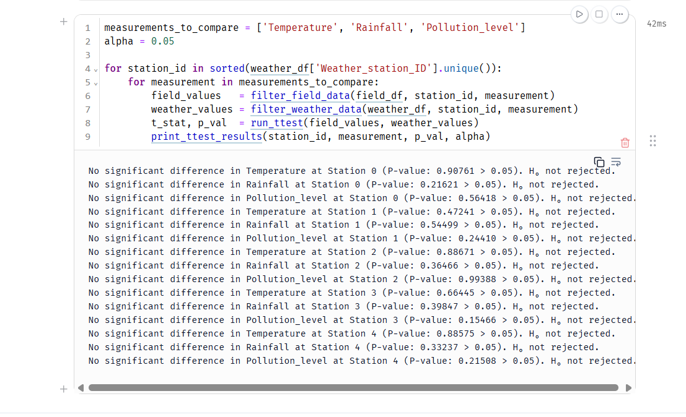

# Maji Ndogo Statistical Audit

## Executive Summary

This audit examined whether selected measurements in the Maji Ndogo farm survey showed mean differences from corresponding weather-station measurements. The pipeline produced 5,654 field records and 1,843 processed weather records, and the analysis ran 15 Welch’s two-sample t-tests across five stations. At a significance threshold of 0.05, none of the comparisons detected statistically significant mean differences in temperature, rainfall, or pollution level. These results do not establish equivalence, practical agreement, or the reliability of every survey variable. I recommend treating this analysis as a limited consistency check and verifying measurement comparability and test assumptions before making a broader trust judgment.

## Background

The Ministry’s agricultural decisions depend on reliable survey data. This audit examined one aspect of that reliability by comparing field measurements with weather-station observations.

The processed field dataset contained 5,654 records and 19 columns. The processed weather dataset contained 1,843 records and four columns covering five stations. These totals describe the datasets, rather than the sample sizes used in each individual test.

The audit focused on temperature, rainfall, and pollution level. It did not assess every agricultural variable or establish whether either data source was free from measurement error.

## Method

The field-data pipeline loaded records from a SQLite database, corrected swapped column names and crop spelling errors, and merged the field-to-station mapping. The weather-data pipeline loaded and processed station observations.

For each of the five stations, the analysis selected the corresponding field and station values for temperature, rainfall, and pollution level. It then ran a two-sided Welch’s independent-samples t-test for each measurement, giving 15 comparisons in total.

Each test assessed the null hypothesis that the two population means were equal, using a significance threshold of 0.05. Welch’s test allows unequal sample sizes and variances, but its interpretation still depends on assumptions such as independent observations and comparable measurements.

## Findings

### F-1 — No statistically significant mean differences detected

The 15 Welch’s tests did not detect statistically significant differences in mean temperature, rainfall, or pollution level between the field and weather-station samples at any of the five stations, using a significance threshold of 0.05. These results do not prove the means are equal or that the survey data is fully trustworthy.

## Limitations

- **Failure to reject is not proof of equality.** All 15 p-values exceeded 0.05, but meaningful differences could remain undetected.

- **Practical agreement was not established.** The displayed results do not report mean differences, confidence intervals, or an acceptable difference defined for the Ministry’s decisions.

- **Measurement comparability needs verification.** Units, observation periods, geographic coverage, and aggregation methods must be checked before interpreting field and station measurements as directly comparable.

- **Independence needs verification.** Repeated observations at a station or fields sharing local conditions could create dependence that affects the tests.

- **The audit has limited scope.** Comparing three measurements does not validate every survey variable or establish causal relationships.

- **The earlier one-sample findings remain unresolved here.** The course describes significant rainfall discrepancies at four of five stations in the earlier analysis. Its executed results and fixed reference values have not been included in this report, so this report does not independently reconcile those findings with the Welch’s results.

## Verdict

I found no statistically significant mean differences in the 15 field-to-station comparisons shown in Exhibit A. I regard this as a limited consistency check, rather than proof that the survey is fully trustworthy. Before recommending broader reliance on the data, I would verify measurement comparability and independence, examine mean differences and confidence intervals, and reconcile the earlier rainfall findings using their original evidence. I would also agree with the Ministry on what size of difference would matter in practice.

*Maintained by Mupembe Tshisekedi*
